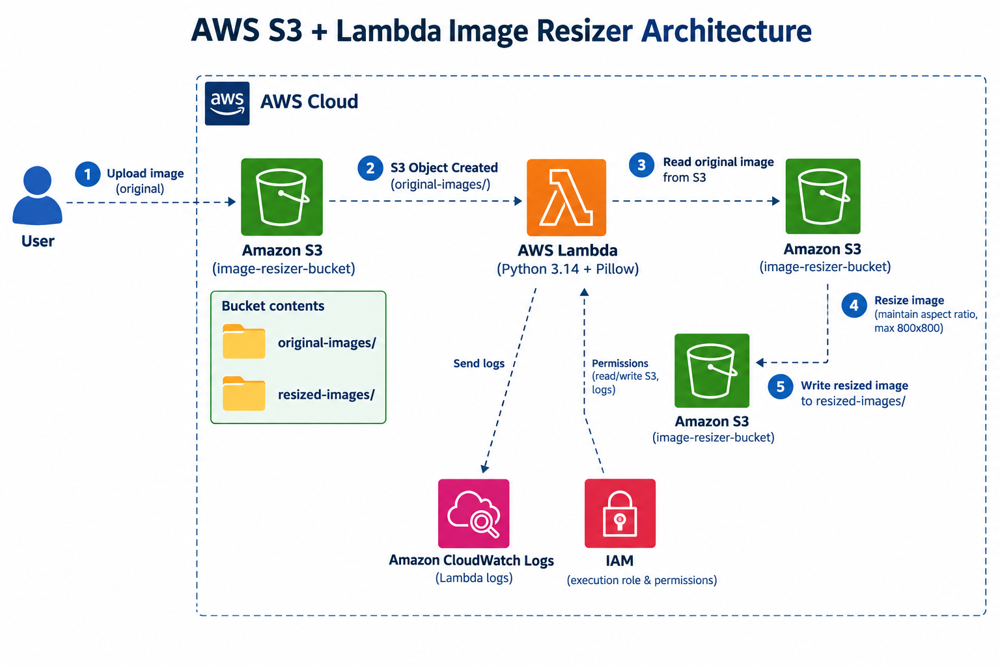

# AWS Lambda Automated S3 Image Resizer

An automated serverless image-processing pipeline built with **Amazon S3 + AWS Lambda + Python 3.14 + Pillow**.

When a full-size image is uploaded to `original-images/`, an S3 Object Created event invokes Lambda. Lambda reads the image, resizes it while preserving its aspect ratio, and writes the result to `resized-images/`.

## 🏗️ Project Architecture

The architecture below is designed in the same flow-oriented style as the reference architecture, but specifically for this S3 image-resizer project.



### Flow

```text
User
  |
  | 1. Upload full-size image
  v
Amazon S3: original-images/
  |
  | 2. S3 ObjectCreated event
  v
AWS Lambda (Python 3.14 + Pillow)
  |
  | 3. Read image from S3
  | 4. Resize to max 800x800, preserving aspect ratio
  | 5. Write resized image
  v
Amazon S3: resized-images/
  |
  v
Resized image available for use
```

### Supporting AWS services

- **IAM** — Lambda execution role with permission to read originals, write resized images, and write CloudWatch logs.
- **Amazon CloudWatch Logs** — Lambda execution and error logs.
- **Amazon S3 Event Notifications** — triggers Lambda only for objects created under `original-images/`.

---

## 📁 Repository Structure

```text
s3-image-resizer-repo/
├── architecture.png
├── lambda_function.py
├── requirements.txt
├── README.md
├── original-images/
│   └── image.webp
└── resized-images/
    └── image.webp
```

## 🖼️ Image Examples

### Original image

The repository includes a full-size demo image under `original-images/`.

**Original:** 1600 × 1000


### Resized image

The corresponding resized demo image is under `resized-images/`.

**Resized:** 800 × 500


The Lambda function uses:

```python
MAX_SIZE = (800, 800)
```

Pillow's `thumbnail()` keeps the original aspect ratio, so a 1600 × 1000 image becomes 800 × 500 rather than being stretched.

---

## ☁️ S3 Folder Structure

Use an S3 bucket such as:

```text
image-resize-trigger-s3/
├── original-images/
│   └── image.webp
└── resized-images/
    └── image.webp
```

**Important:** upload original images only into `original-images/`. The Lambda function skips objects outside that prefix, preventing an output upload from triggering another resize cycle.

---

## ⚙️ Lambda Configuration

- **Runtime:** Python 3.14
- **Handler:** `lambda_function.lambda_handler`
- **Maximum output dimensions:** 800 × 800
- **Image library:** Pillow
- **Input prefix:** `original-images/`
- **Output prefix:** `resized-images/`

### Required S3 permissions

The Lambda execution role should allow:

```text
s3:GetObject
    arn:aws:s3:::image-resize-trigger-s3/original-images/*

s3:PutObject
    arn:aws:s3:::image-resize-trigger-s3/resized-images/*
```

It also needs the normal CloudWatch Logs permissions:

```text
logs:CreateLogGroup
logs:CreateLogStream
logs:PutLogEvents
```

---

## 🔔 S3 Event Notification

Configure the S3 bucket to invoke the Lambda function for:

```text
Event type: s3:ObjectCreated:*
Prefix: original-images/
Destination: Lambda function
```

This means an upload such as:

```text
original-images/image.webp
```

triggers the Lambda function, which creates:

```text
resized-images/image.webp
```

---

## 🧪 Test

1. Upload `original-images/image.webp` to the S3 bucket.
2. Open **AWS Lambda → Monitor → CloudWatch logs** and check the execution.
3. Open the S3 bucket.
4. Verify the new file under `resized-images/`.
5. Download the resized image and compare its dimensions with the original.

---

## 📦 Dependencies

`requirements.txt` contains:

```text
Pillow>=10.0.0
boto3>=1.28.0
```

For Lambda deployment, make sure Pillow is packaged in a Lambda-compatible deployment package or Lambda Layer.

---

## 👤 Author

**Niranjan J U**
